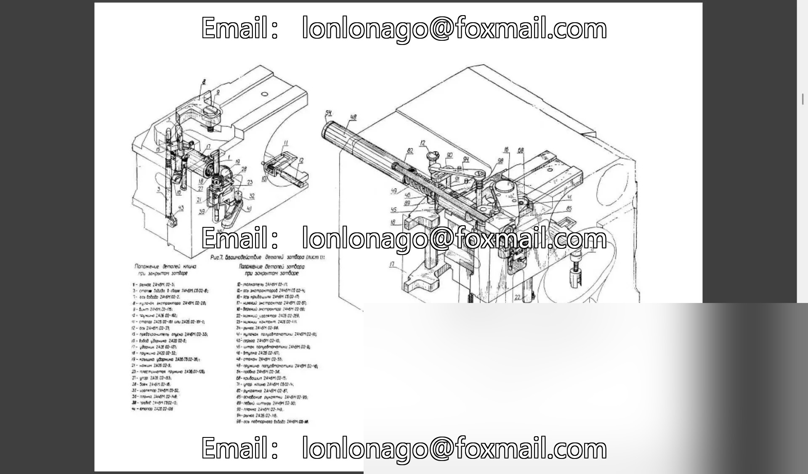
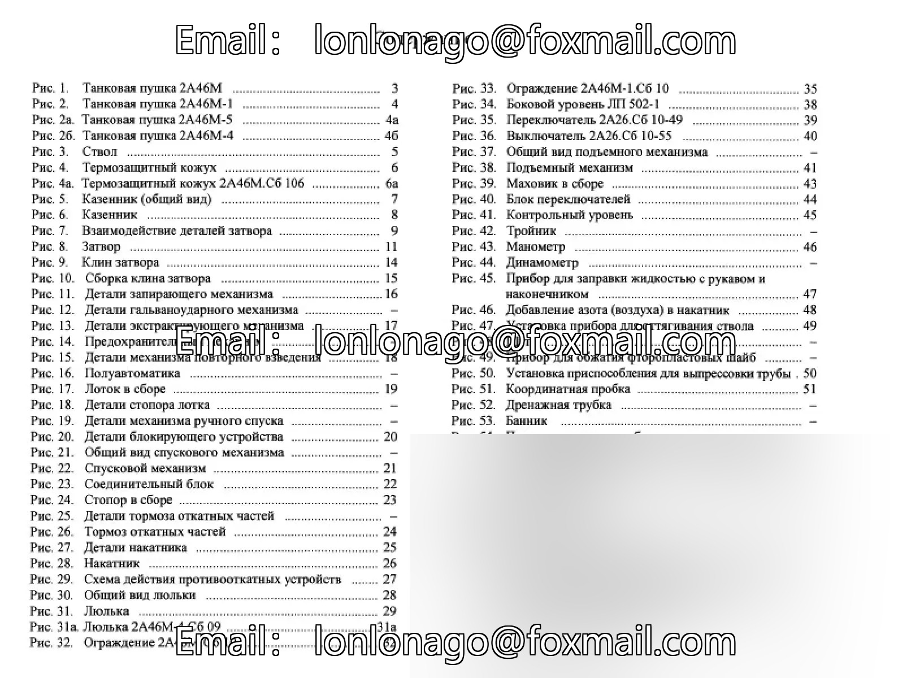
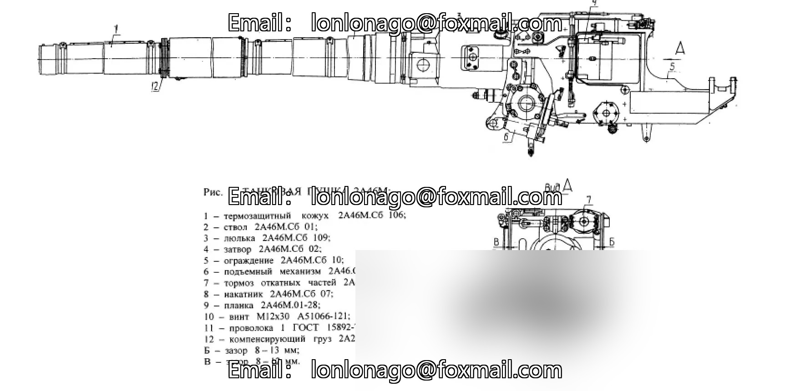
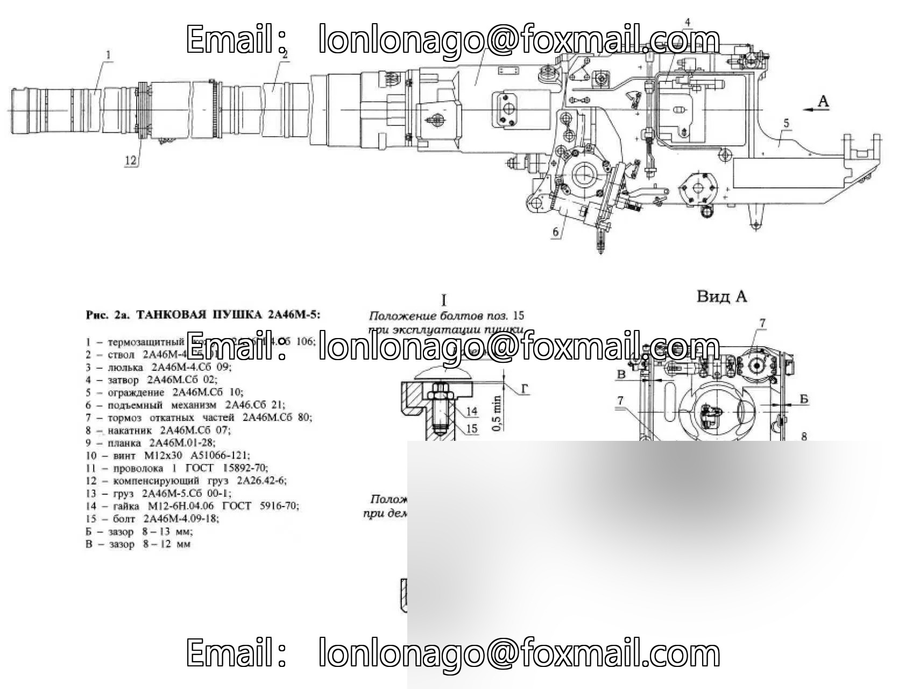
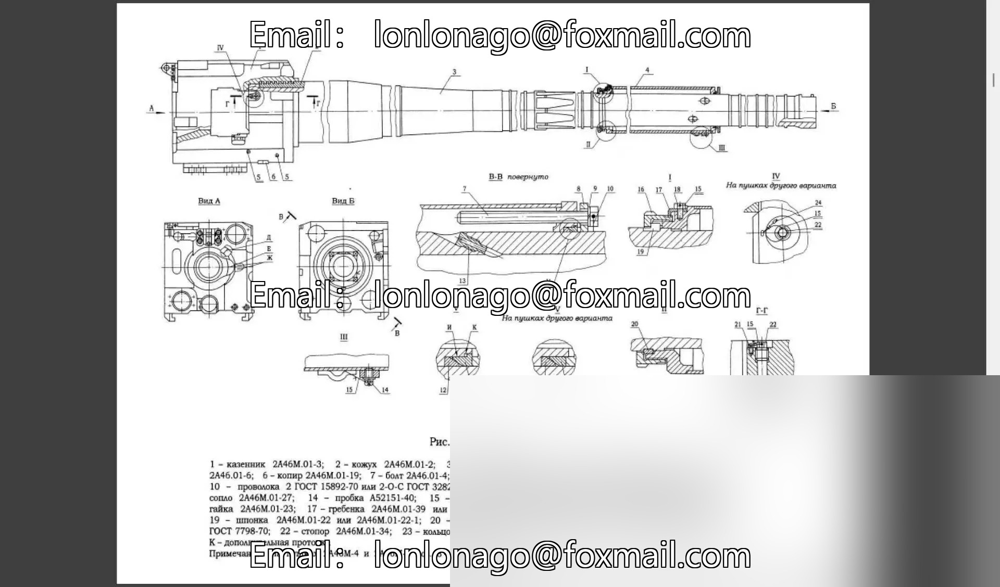
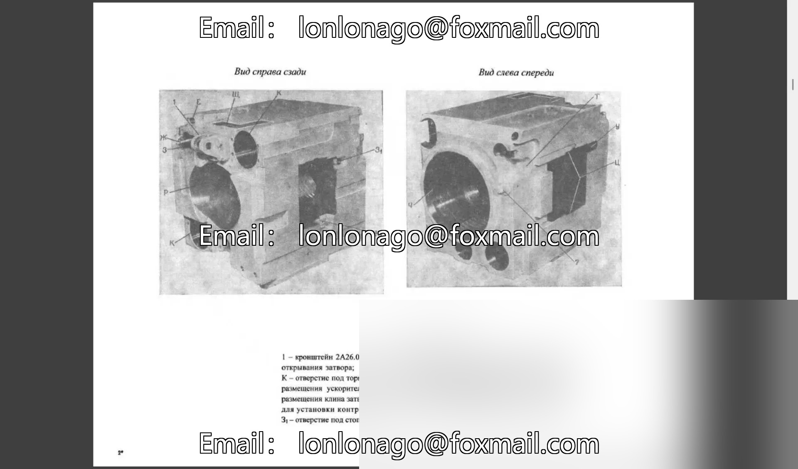
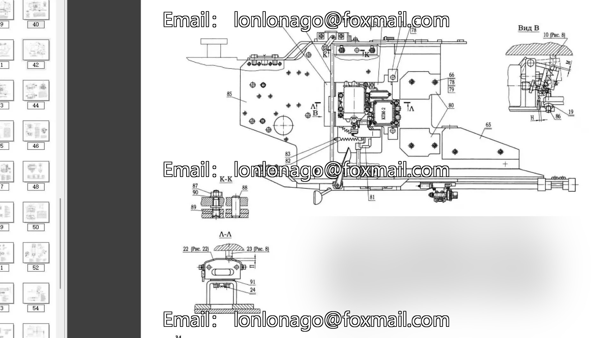

# 125mm tank cannon 2A46M, 2A46M-1, 2A46M-4

## Body

125-meter tank gun 2A46M, 2A46M-1, 2A46M-4, 2A46M-5 technical specifications and operation instructions, 2A46M.TO version, electronic data PDF format, covering technical parameters, operation procedures, maintenance and other content, suitable for military enthusiasts and professionals to reference.
Core coverage includes:

Tank cannon main body (such as "TANKOVAYA PUŠKÁ 2A46M", "STVOL (cannon tube)")

Key functional components (such as "razavnaya chitka", "kazonnik", "podyevnyushchiy mehanizm", "spускovyy mehanizm")

Auxiliary system and operation (such as "Prisons (shield)","Level (level gauge)","Lubrication","Installation/Tuning") ;

Detailed parts and sub-systems (such as "Locking mechanism (secure mechanism parts)""Cannonlock (cannon cap wedge iron)""Recoil control parts (recoil control brake)" etc.).

The materials are in an , can be copied, upon sale.

The materials provide technical descriptions, operation procedures and maintenance instructions for 125mm tank gun variants 2A46M, 2A46M-1, 2A46M-4 and related versions, in PDF format, including technical parameters, operation flows and maintenance; they are suitable for military enthusiasts and professionals.

<!-- AI_ENRICHED -->

## Images

## Payment

Here is a pay link on Stripe ( https://buy.stripe.com/3cs8yP7sY87d0vu9AB ). Please contact me lonlonago@foxmail.com after funding $89, and I will send you a complete data files , thank you!

